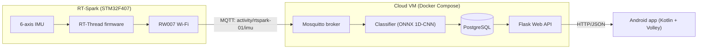
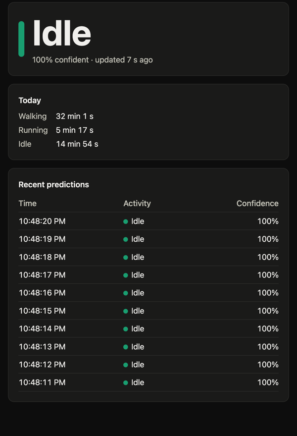

# RT-Spark Activity Recognition

[](https://github.com/TristanListanco/rt-spark-activity-recognition/actions/workflows/repo.yml)
[](https://github.com/TristanListanco/rt-spark-activity-recognition/actions/workflows/cloud.yml)
[](https://github.com/TristanListanco/rt-spark-activity-recognition/actions/workflows/ml.yml)
[](https://github.com/TristanListanco/rt-spark-activity-recognition/actions/workflows/firmware.yml)
[](https://github.com/TristanListanco/rt-spark-activity-recognition/actions/workflows/android.yml)

Laboratory Activity 3: a full-stack IoT system that classifies walking, running and standing still (idle) in real time.

The RT-Spark board streams accelerometer and gyroscope readings over Wi-Fi/MQTT to a cloud service. There, a small 1D-CNN classifies the activity and the result is stored in PostgreSQL. A Flask API serves the results to an Android app.

## Laboratory alignment

The activity brings together cloud services and machine learning, embedded firmware, and a mobile app. The lab recommends developing them in that order; the simulated publisher lets the cloud be checked before connecting the physical board.

| Laboratory requirement | How this project addresses it |
|---|---|
| Read accelerometer and gyroscope data and send it over Wi-Fi/MQTT | [IMU firmware](firmware/applications/imu.c) reads all six axes; [network firmware](firmware/applications/net.c) sends one batch per second through the RW007 |
| Provide an MQTT broker, classifier, database and web API | [Docker Compose](cloud/docker-compose.yml) runs Mosquitto, the ONNX classifier, PostgreSQL and Flask locally or on an Azure VM |
| Investigate the dataset's measurement units and collection conditions | [Dataset exploration](ml/explore.py) checks the 5 Hz rate, gravity, sensor units and wrist placement; findings are in the [ML report](docs/ml-report.md#1-dataset) |
| Use temporal information while keeping the model lightweight | [The CNN](ml/activity_ml/model.py) learns across successive samples on all axes; comparisons with a simpler statistics baseline justify the model choice |
| Evaluate generalization and collect additional data | [Evaluation scripts](ml/evaluate.py) test held-out days, rotated devices and cross-wrist transfer; [board evaluation](ml/evaluate_own.py) tests recorded walk/run/idle data |
| Show live predictions and history in a responsive Android app | Kotlin/Compose screens use asynchronous Volley requests, coroutines and ViewModels, with separate data/UI layers and connection-error states |

For a physical demonstration, use an RT-Spark with its onboard sensors and Wi-Fi, a USB data cable, a 2.4 GHz IPv4 network and an Android 8.0+ phone. Development uses Docker Compose, Python, the Arm toolchain/PlatformIO and Android Studio; Azure CLI is needed only to provision the cloud VM. The local simulated demonstration needs neither the board nor the training CSVs because the pretrained ONNX model is committed.

## Architecture



Message formats, API endpoints and the database schema are in [docs/CONTRACTS.md](docs/CONTRACTS.md). The final end-to-end checks are in [docs/verification.md](docs/verification.md).

The shared sensor settings are important when reproducing the project:

| Setting | Value |
|---|---|
| Sample order and units | `[ax, ay, az, gx, gy, gz]`; acceleration in g with gravity included, angular velocity in rad/s |
| Sampling and transmission | 5 Hz: five samples per MQTT message, one message per second |
| Classification window | 20 samples (4 s), updated once per second; the first prediction needs four batches |
| Prediction feedback | `activity/<device_id>/prediction` returns the cloud's label and confidence to the board's LCD |
| Timestamps | Unix milliseconds; an IMU batch timestamps its first sample, while a prediction timestamps its newest sample. Before NTP sync the board sends `0`, and the classifier uses arrival time |

The classifier drops invalid payloads or rates other than 5 Hz and resets a device's window after a gap longer than 3 s. This prevents mixing samples from before and after a stream interruption.

### Web API

The latest, history and summary endpoints take `device_id` (e.g. `rtspark-01`); health and the live page do not. API responses are JSON; timestamps are Unix milliseconds. Full details in [CONTRACTS.md, section 4](docs/CONTRACTS.md#4-web-api-cloud--app).

| Endpoint | Returns |
|---|---|
| `GET /api/health` | `{"status": "ok"}`, or 503 if the database is down |
| `GET /api/latest?device_id=…` | The newest prediction: activity, confidence, time |
| `GET /api/history?device_id=…&limit=50&before=<ts>` | Predictions, newest first, paged with `before` |
| `GET /api/summary?device_id=…&date=YYYY-MM-DD` | Seconds per activity (walk, run, idle) on that day |
| `GET /` | Live web page |

Invalid query parameters return `400`; latest returns `404` when a device has no predictions, and database-dependent requests return `503` during a database outage. Daily summary values count predictions as seconds at the expected one-prediction-per-second rate; they do not fill gaps in missing data. The day is determined in `APP_TIMEZONE`, which defaults to `Asia/Manila`.

## Repository layout

| Path | Contents |
|---|---|
| `firmware/` | RT-Thread project for the RT-Spark: IMU sampling, Wi-Fi, MQTT publishing |
| `cloud/` | Docker Compose stack: Mosquitto, PostgreSQL, classifier service, Flask API |
| `ml/` | Dataset exploration, preprocessing, training, exported ONNX model |
| `tools/` | `fake_publisher.py` (simulates the board), `record.py` (records labelled board data) |
| `app/` | Android app: live prediction and history |
| `docs/` | Interface contracts, ML report |

## Progress

- [x] M0: Repository set up
- [x] M1: Local cloud stack (broker, DB, API stub, fake publisher)
- [x] M1b: Firmware toolchain builds and flashes the stock BSP
- [x] M2: ML model trained and exported
- [x] M3: Classifier + API working end to end with simulated data
- [x] M4: Firmware publishes real IMU data over Wi-Fi/MQTT
- [x] M5: Android app
- [x] M6: Deployed to an Azure VM
- [x] M7: Own data recorded with the board; idle class added
- [x] M8: Final verification ([docs/verification.md](docs/verification.md))
- [ ] Demo video

The M8 report records verification on **October 31, 2026, 22:38-22:48 Asia/Manila**. It leaves explicit confirmation of wrist-worn walk/run transitions, the phone on mobile data and recovery from actual board Wi-Fi loss for the physical demonstration. The results and screenshots below reflect that recorded scope.

## Running it

Start from a full clone and run the following commands from its root unless a step changes directory:

```bash
git clone --recurse-submodules https://github.com/TristanListanco/rt-spark-activity-recognition.git
cd rt-spark-activity-recognition
```

### Cloud stack (local)

Needs Docker. Four services run from `cloud/docker-compose.yml`:

| Service | Port | Role |
|---|---|---|
| `mosquitto` | 1883 | MQTT broker; password auth only, credentials from `cloud/.env` |
| `db` | internal | PostgreSQL 16; schema in `cloud/db/init.sql` |
| `classifier` | — | Subscribes to `activity/+/imu` and validates each message against the contract. Keeps a 4 s window per device, classifies it once per second with `ml/models/model.onnx` (ONNX Runtime; no PyTorch in the image), and writes the result to `predictions` |
| `api` | 8000 | Flask API over the `predictions` table (contract section 4), plus a live web page at `/` |

```bash
cp cloud/.env.example cloud/.env        # then set real passwords
docker compose -f cloud/docker-compose.yml up -d --build --wait

curl http://localhost:8000/api/health
open http://localhost:8000/             # live page
```

Simulate the board with `tools/fake_publisher.py`, which reads the MQTT credentials from `cloud/.env`. Its default signals are simple but physically plausible, so the model labels them correctly. Add `--csv ml/data/dataset.csv` to replay real dataset rows instead.

These synthetic signals verify integration, not real-world model accuracy. Stop the publisher before connecting a board with the same device ID, or pass `--device-id demo-01` and query that ID separately.

```bash
python3 -m venv .venv && .venv/bin/pip install -r tools/requirements.txt
.venv/bin/python tools/fake_publisher.py                   # alternate walk/run every 30 s
.venv/bin/python tools/fake_publisher.py --activity run --count 10

curl "http://localhost:8000/api/latest?device_id=rtspark-01"
mosquitto_sub -h localhost -u device -P <MQTT_PASSWORD> -t 'activity/#' -v   # raw traffic
docker compose -f cloud/docker-compose.yml logs -f classifier                # one line per prediction
```

`cloud/scripts/smoke_test.sh` checks the whole path end to end, and CI runs the same script:
1. Start the stack and check the API and database are healthy.
2. Check the broker rejects anonymous clients.
3. Simulate a board that walks for 6 s and then runs for 6 s.
4. Expect one stored prediction per message once the 4 s window is full (9 of 12), a latest label of "run", both activities in the history, a matching daily summary, the web page loading, and a clean classifier log.

Replaying real dataset rows through the running stack, the label switched to "run" about 2 s after the data switched.



Port 8000 is used instead of 5000 because macOS reserves 5000 for AirPlay Receiver.

For **Windows PowerShell**, the equivalent local setup is below. Install Python 3.12 with the Windows Python launcher first, and edit the copied `.env` before starting Docker. Choose your own MQTT/database passwords; the publisher and board must use the broker's matching credentials.

```powershell
Copy-Item cloud/.env.example cloud/.env
# Edit cloud/.env before continuing.
docker compose --env-file cloud/.env -f cloud/docker-compose.yml up -d --build --wait
py -3.12 -m venv .venv
.\.venv\Scripts\python.exe -m pip install -r tools/requirements.txt
.\.venv\Scripts\python.exe tools/fake_publisher.py --switch-every 6 --count 12
Invoke-RestMethod "http://localhost:8000/api/latest?device_id=rtspark-01"
Start-Process http://localhost:8000/
```

Inspect services with `docker compose -f cloud/docker-compose.yml ps`. Stop them with `docker compose -f cloud/docker-compose.yml down`; named database volumes are retained.

### Cloud deployment (Azure)

The same Docker Compose stack runs on an Azure VM, so the board and the phone work from any network, including mobile data:

The address and VM details below describe the project's recorded deployment. When creating your own VM, use the hostname printed by the setup script in the board and app settings, and check region access, quotas and costs in your subscription. This stack uses password-authenticated MQTT on port 1883 and plain HTTP; TLS is not configured.

| | |
|---|---|
| VM | `activity-vm`, Ubuntu 24.04, Standard_B2ats_v2 (2 vCPU, 1 GB RAM + 2 GB swap), region East Asia |
| Address | `rtspark-activity-b2093c.eastasia.cloudapp.azure.com` (static IP) |
| MQTT | `rtspark-activity-b2093c.eastasia.cloudapp.azure.com:1883`, password auth (same credentials as `cloud/.env`) |
| API | `http://rtspark-activity-b2093c.eastasia.cloudapp.azure.com/api/...` and the live page at `http://rtspark-activity-b2093c.eastasia.cloudapp.azure.com/` |
| Firewall | SSH only from the deploying computer's IP; 1883 and 80 open |

Two scripts reproduce it (Azure CLI, after `az login`):

```bash
LOCATION=eastasia SIZE=Standard_B2ats_v2 cloud/scripts/azure_create_vm.sh   # VM, static IP + DNS name, firewall
cloud/scripts/azure_deploy.sh rtspark-activity-b2093c.eastasia.cloudapp.azure.com              # pull repo, copy .env over SSH, start, smoke test
```

`azure_deploy.sh` is also how to ship updates: push to GitHub, then run it again. The first-boot setup is in `cloud/deploy/cloud-init.yaml` (Docker, git, swap). Notes:
- The student subscription only allows a few regions (East Asia, Japan East, Malaysia West, Indonesia Central, Australia East). B1s had no capacity in East Asia, so the VM is a B2ats v2, which has the same 1 GB of RAM and is also in Azure's free tier.
- With all four containers running, the VM uses about 420 MB of RAM.
- If your public IP changes, re-allow SSH: `az network nsg rule update -g rg-activity --nsg-name activity-vmNSG -n ssh-from-my-ip --source-address-prefixes $(curl -s https://api.ipify.org)/32`.
- Remove everything with `az group delete -n rg-activity`.

### Machine learning

`ml/` is a [uv](https://docs.astral.sh/uv/) project (Python 3.12). On Linux it installs the CPU-only PyTorch build. Put the Kaggle run-or-walk CSV at `ml/data/dataset.csv` (it is not committed), then:

```bash
cd ml
uv sync
uv run python explore.py    # dataset facts + figures (docs/ml/)
uv run python evaluate.py   # compare models on unseen days, rotated devices, other wrist (~13 min)
uv run python evaluate_own.py   # test on board recordings in ml/data/own/, pick the 3-class setup (~4 min)
uv run python train.py      # train the deployed model → models/model.onnx + model_meta.json
uv run pytest
```

The exported model takes raw 4 s windows `(batch, 20, 6)` in g and rad/s and returns `[walk, run, idle]` probabilities. Walk and run come from the Kaggle data plus board recordings, idle from board recordings only (`tools/record.py`). Magnitude channels and normalization happen inside the ONNX file, so the classifier service needs only numpy and ONNX Runtime.

The Kaggle data contains 88,588 samples from one person's wrist-worn phone across 12 days. The deployed CNN has **1,235 parameters**: six sensor axes plus two magnitude channels pass through two temporal convolution layers, global average pooling and a three-class softmax. This uses temporal information while keeping inference small; the [ML report](docs/ml-report.md#6-the-labs-design-questions) discusses accuracy, compute/memory cost and probabilistic output. Softmax confidence is not calibrated as an exact probability of correctness.

To collect board data, use LEFT for `walk`, RIGHT for `run`, UP for `idle`, and DOWN to stop labelling; serial equivalents are `rec walk`, `rec run`, `rec idle` and `rec stop`. From the repository root, `.venv/bin/python tools/record.py --host <broker-host>` saves labelled CSVs under `ml/data/own/` using credentials from `cloud/.env`. On PowerShell, use `.\.venv\Scripts\python.exe` instead. The classifier ignores these labels when predicting live activity.

**Reproducing training requires the raw data.** The Kaggle CSV and board recordings are not committed. Without board recordings, `train.py` falls back to a two-class model and cannot reproduce `idle`. Training overwrites model artifacts; use `--out-dir models/experiment` to keep an experiment separate from the committed model.

### Firmware

RT-Thread on the RT-Spark, using RT-Thread's official `stm32f407-rt-spark` board package with its RW007 Wi-Fi and ICM-20608 IMU drivers. The firmware samples at 5 Hz and publishes one MQTT message per second. Its LCD shows the cloud's prediction (sent back over MQTT) and the board's status. Details, LED meanings and serial commands: [firmware/README.md](firmware/README.md).

The only prerequisite is the Arm GCC toolchain (GCC 14.2, native on Apple Silicon, no admin rights):

```bash
pio pkg install --global --tool "platformio/toolchain-gccarmnoneeabi@1.140201.0"
```

`firmware/build.sh` does the rest: it fetches RT-Thread at a pinned commit (only the parts this board needs), installs RT-Thread Env if missing, copies this project's code and configuration onto the board package, and builds. It flashes through the on-board ST-Link with PlatformIO's OpenOCD.

```bash
cp firmware/applications/secrets.example.h firmware/applications/secrets.h   # Wi-Fi + MQTT settings
firmware/build.sh flash
pio device monitor -p /dev/cu.usbmodem* -b 115200
```

On macOS, the first time the board is plugged in you have to click **Allow** on the "Allow accessory to connect?" prompt. The board needs a **2.4 GHz, IPv4** Wi-Fi network; a phone hotspot works.

The handout's reference firmware uses LSM6DSL/ISM43362, CubeMX, CMSIS-Driver and FreeRTOS/coreMQTT. This implementation adapts that sensor -> Wi-Fi -> MQTT sequence to RT-Thread, ICM-20608/RW007 and Paho. Its board/package configuration is in [tools/firmware_config.py](tools/firmware_config.py) and `firmware/.config`; the reference setup's SPI3, pack-installation and `solution.yml` edits are not build steps for this repository.

The shell build/deployment scripts target macOS/Linux; on Windows use a Bash/Linux environment such as WSL2, with USB/ST-Link access for flashing. Set each `WIFI_NETWORKS` entry in `secrets.h` to your network and reachable broker address, and match the MQTT credentials in `cloud/.env`. Check `imu_read` for sensor readings and `app_status` for Wi-Fi, MQTT and publish status. A build without `secrets.h` uses placeholders and does not establish a working hardware connection.

### Android app

A native Android app (Kotlin, Jetpack Compose, Material 3) that polls the API with **Volley**, as the lab recommends. Minimum Android 8.0 (API 26).

| Live | History | API unreachable |
|---|---|---|
|  |  |  |

Screenshots from a Pixel 7 showing the board's real data through the Azure deployment.

- **Live:** the current activity in a large card (blue for walking, orange for running, green for idle, grey when no data has arrived for 10 s), its confidence and age, and today's time per activity with a proportional bar. It polls `/api/latest` every second while visible and stops when the app is in the background.
- **History:** the API's one-prediction-per-second records merged into stretches ("Running · 20:50:41 – 20:51:01 · 21 s · 99%"). Pull to refresh; older pages load as you scroll (`before=` paging).
- **Settings:** API address and device ID, saved on the phone, with **Test connection** (`/api/health`). The default is the Azure deployment, `http://rtspark-activity-b2093c.eastasia.cloudapp.azure.com` (build with `-Pactivity.apiUrl=...` to change it). For the local stack, enter the computer's address, e.g. `http://10.0.2.2:8000` on the emulator or `http://192.168.1.44:8000` from a phone on the same Wi-Fi.

```bash
cd app
./gradlew installDebug          # build and install on a connected phone or a running emulator
./gradlew testDebugUnitTest     # 27 unit tests: JSON parsing, history stretches, formatting, Live ViewModel and card text
./gradlew lintDebug
```

Or open `app/` in Android Studio. Gradle needs JDK 17 or newer (Android Studio's bundled JDK works: `export JAVA_HOME="/Applications/Android Studio.app/Contents/jbr/Contents/Home"`). Missing SDK parts (platform 37, build-tools 36) are installed automatically on the first build.

On **Windows PowerShell**, use the checked-in Windows wrapper from `app/` (CI uses JDK 21):

```powershell
cd app
.\gradlew.bat installDebug
.\gradlew.bat testDebugUnitTest lintDebug
```

Use `assembleDebug` to build without installing; the APK is at `app/app/build/outputs/apk/debug/app-debug.apk` relative to the repository root. A physical phone needs the computer's LAN IP for a local API: `localhost` refers to the phone itself. Use the documented `10.0.2.2:8000` address on the emulator.

Structure: `data/` holds the Volley client wrapped in coroutines, JSON parsing, the repository (behind an interface, so ViewModels are tested with a fake) and the DataStore settings. `ui/live`, `ui/history` and `ui/settings` each have a ViewModel exposing a `StateFlow`, and `ui/theme` holds the project palette. Notes:
- `targetSdk` stays at 36: targeting Android 17 may opt in to its local-network restrictions, and this app talks to a server on the local network.
- Plain HTTP is allowed (`network_security_config.xml`) because the API address is set at runtime.

## Continuous integration

Each part has its own GitHub Actions workflow in `.github/workflows/`. A workflow runs only when its folder changes, and its jobs skip until that part of the project exists.

`repo.yml` is the exception: it runs on pull requests and pushes to `main`, including README-only changes. Firmware compilation, host tests, simulated integration and physical-board verification cover different checks; a successful build does not replace the lab demonstration.

| Workflow | Runs when | What it does |
|---|---|---|
| `repo.yml` | every push/PR | Fails if `.env`, `secrets.h`, keystores or the lab handout are committed, or if any file is over 10 MB. Lints the workflows (actionlint) and all Python (ruff, config in `ruff.toml`) |
| `cloud.yml` | `cloud/`, `tools/`, `ml/activity_ml/`, `ml/models/` | `pytest` for the API and classifier against a Postgres service (`DATABASE_URL`). Builds the Compose stack and runs `cloud/scripts/smoke_test.sh` |
| `ml.yml` | `ml/` | `uv sync --locked`, then `pytest` (preprocessing and exported-model checks; no training in CI) |
| `firmware.yml` | `firmware/`, `cloud/classifier/payload.py` | Compiles the firmware's message code on the host and checks its JSON with the cloud classifier's validator. Then `firmware/build.sh` builds the image (pinned RT-Thread, cached between runs) with placeholder secrets, reports flash/RAM size, and uploads `rtthread.bin` |
| `android.yml` | `app/` | Validates the Gradle wrapper, then `lintDebug testDebugUnitTest assembleDebug`. Uploads the debug APK |

## Results

Full details in [docs/ml-report.md](docs/ml-report.md). The model is a 1D-CNN (about 1,200 parameters, 30 KB ONNX, ≈0.01 ms per prediction), trained with left/right mirroring and random 3D rotations.

**M2, walk/run on the Kaggle data** (2 s windows):

| Test | Accuracy |
|---|---|
| Unseen recording day (12-fold) | 99.71% |
| Unseen day, device rotated to a random orientation | 99.70% |
| Train left wrist → test right / train right → test left | 99.62% / 98.82% |

**M7, on data recorded with the RT-Spark** (about 8 minutes; one session each of walking, running and standing still):

| Test | Accuracy |
|---|---|
| M2 model (Kaggle only), walk/run recorded with the board | 99.6% |
| The same CNN trained without rotations | 52.8% |
| Deployed 3-class model, held-out stretches of the board recordings | 97.2% (walk 94.5%, run 100%, idle 97.5%) |
| Deployed 3-class model, unseen Kaggle days | 99.7% |

The CNN trained without rotations learned *how the iPhone was worn* instead of how walking and running move. On the board it calls almost everything "run". With rotation training, the model trained only on iPhone data works on the board. The 2-class model labelled standing still as "run", so M7 added an idle class, learned from the board recordings. The deployed model uses 4 s windows, which separate idle from walking better than 2 s windows (97.2% vs 94.1%). With one session per activity, these board numbers are optimistic (report, section 10).

The evaluation avoids randomly splitting neighboring, overlapping windows: Kaggle tests hold out whole days, while board tests hold out time blocks and exclude training windows that could share samples with them. Model settings were selected using the same board folds that report the score. The final exported model was trained on all available board data, so the reported 97.2% is the configuration's cross-validation result, not an independent test of that final artifact. More wearers and separate recording sessions are needed to assess wider generalization.

## Demo

_Link to the demo video._

When available, the recording should show the configured board publishing data, walking/running/idle on the LCD and Android app, stored history, and the remaining mobile-data and Wi-Fi-recovery checks noted in [the verification report](docs/verification.md).
