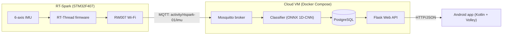

# RT-Spark Activity Recognition

Laboratory Activity 3: a full-stack IoT system that classifies walking vs. running in real time.

The RT-Spark board streams accelerometer and gyroscope readings over Wi-Fi/MQTT to a cloud service. There, a small 1D-CNN classifies the activity and the result is stored in PostgreSQL. A Flask API serves the results to an Android app.

## Architecture

Message formats, API endpoints and the database schema are in [docs/CONTRACTS.md](docs/CONTRACTS.md).

## Repository layout

| Path | Contents |
|---|---|
| `firmware/` | RT-Thread project for the RT-Spark: IMU sampling, Wi-Fi, MQTT publishing |
| `cloud/` | Docker Compose stack: Mosquitto, PostgreSQL, classifier service, Flask API |
| `ml/` | Dataset exploration, preprocessing, training, exported ONNX model |
| `tools/` | `fake_publisher.py` (simulates the board), `record.py` (records labelled board data) |
| `app/` | Android app: live prediction and history |
| `docs/` | Interface contracts, ML report |

## Progress

- [x] M0: Repository set up
- [ ] M1: Local cloud stack (broker, DB, API stub, fake publisher)
- [ ] M1b: Firmware toolchain builds and flashes the stock BSP
- [ ] M2: ML model trained and exported
- [ ] M3: Classifier + API working end to end with simulated data
- [ ] M4: Firmware publishes real IMU data over Wi-Fi/MQTT
- [ ] M5: Android app
- [ ] M6: Deployed to an Azure VM
- [ ] M7: Own data collected, model fine-tuned
- [ ] M8: Final test, demo video

## Running it

*Filled in as each part is built.*

### Cloud stack (local)
_Coming in M1._

### Machine learning
_Coming in M2._

### Firmware
_Coming in M4._

### Android app
_Coming in M5._

## Continuous integration

Each part has its own GitHub Actions workflow in `.github/workflows/`. A workflow runs only when its folder changes, and its jobs skip until that part of the project exists.

| Workflow | Runs when | What it does |
|---|---|---|
| `repo.yml` | every push/PR | Fails if `.env`, `secrets.h`, keystores or the lab handout are committed, or if any file is over 10 MB. Lints the workflows (actionlint) and all Python (ruff, config in `ruff.toml`) |
| `cloud.yml` | `cloud/`, `tools/`, `ml/activity_ml/`, `ml/models/` | `pytest` for the API and classifier against a Postgres service (`DATABASE_URL`). Builds the Compose stack and runs `cloud/scripts/smoke_test.sh` |
| `ml.yml` | `ml/` | `uv sync --locked`, then `pytest` (preprocessing and exported-model checks; no training in CI) |
| `firmware.yml` | `firmware/` | Builds the RT-Thread image with `arm-none-eabi-gcc` + SCons using `secrets.example.h`, reports flash/RAM size, uploads `rtthread.bin` |
| `android.yml` | `app/` | Validates the Gradle wrapper, then `lintDebug testDebugUnitTest assembleDebug`. Uploads the debug APK |

## Results

_ML results (session-split, cross-wrist and own-data evaluation) will be summarized here and detailed in `docs/ml-report.md`._

## Demo

_Link to the demo video._
