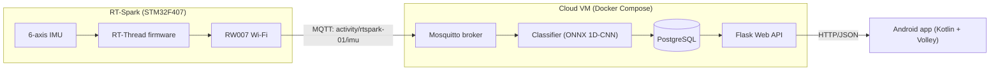

# RT-Spark Activity Recognition

[](https://github.com/TristanListanco/rt-spark-activity-recognition/actions/workflows/repo.yml)
[](https://github.com/TristanListanco/rt-spark-activity-recognition/actions/workflows/cloud.yml)
[](https://github.com/TristanListanco/rt-spark-activity-recognition/actions/workflows/ml.yml)
[](https://github.com/TristanListanco/rt-spark-activity-recognition/actions/workflows/firmware.yml)
[](https://github.com/TristanListanco/rt-spark-activity-recognition/actions/workflows/android.yml)

Laboratory Activity 3: a full-stack IoT system that classifies walking vs. running in real time.

The RT-Spark board streams accelerometer and gyroscope readings over Wi-Fi/MQTT to a cloud service. There, a small 1D-CNN classifies the activity and the result is stored in PostgreSQL. A Flask API serves the results to an Android app.

## Architecture



Message formats, API endpoints and the database schema are in [docs/CONTRACTS.md](docs/CONTRACTS.md).

## Repository layout

| Path | Contents |
|---|---|
| `firmware/` | RT-Thread project for the RT-Spark: IMU sampling, Wi-Fi, MQTT publishing |
| `cloud/` | Docker Compose stack: Mosquitto, PostgreSQL, classifier service, Flask API |
| `ml/` | Dataset exploration, preprocessing, training, exported ONNX model |
| `tools/` | `fake_publisher.py` (simulates the board), `record.py` (records labelled board data) |
| `app/` | Android app: live prediction and history |
| `docs/` | Interface contracts, ML report |

## Progress

- [x] M0: Repository set up
- [x] M1: Local cloud stack (broker, DB, API stub, fake publisher)
- [x] M1b: Firmware toolchain builds and flashes the stock BSP
- [ ] M2: ML model trained and exported
- [ ] M3: Classifier + API working end to end with simulated data
- [ ] M4: Firmware publishes real IMU data over Wi-Fi/MQTT
- [ ] M5: Android app
- [ ] M6: Deployed to an Azure VM
- [ ] M7: Own data collected, model fine-tuned
- [ ] M8: Final test, demo video

## Running it

*Filled in as each part is built.*

### Cloud stack (local)

Needs Docker. Four services run from `cloud/docker-compose.yml`:

| Service | Port | Role |
|---|---|---|
| `mosquitto` | 1883 | MQTT broker; password auth only, credentials from `cloud/.env` |
| `db` | internal | PostgreSQL 16; schema in `cloud/db/init.sql` |
| `classifier` | — | Subscribes to `activity/+/imu`. For now it validates each message against the contract and logs it; the model arrives in M3 |
| `api` | 8000 | Flask API. For now it serves generated data (30 s walk / 30 s run) so the app can be built early; real data arrives in M3 |

```bash
cp cloud/.env.example cloud/.env        # then set real passwords
docker compose -f cloud/docker-compose.yml up -d --build --wait

curl http://localhost:8000/api/health
curl "http://localhost:8000/api/latest?device_id=rtspark-01"
```

Simulate the board with `tools/fake_publisher.py`, which reads the MQTT credentials from `cloud/.env`:

```bash
python3 -m venv .venv && .venv/bin/pip install -r tools/requirements.txt
.venv/bin/python tools/fake_publisher.py                   # alternate walk/run every 30 s
.venv/bin/python tools/fake_publisher.py --activity run --count 10

# Watch the raw MQTT traffic and what the classifier receives
mosquitto_sub -h localhost -u device -P <MQTT_PASSWORD> -t 'activity/#' -v
docker compose -f cloud/docker-compose.yml logs -f classifier
```

`cloud/scripts/smoke_test.sh` runs all of this end to end: start the stack, check the API, check the broker rejects anonymous clients, publish 5 messages, and confirm the classifier received them. CI runs the same script.

Port 8000 is used instead of 5000 because macOS reserves 5000 for AirPlay Receiver.

### Machine learning
_Coming in M2._

### Firmware

The board runs RT-Thread, using its official `stm32f407-rt-spark` board support package (BSP). That package already includes drivers for the on-board RW007 Wi-Fi (SPI2) and ICM-20608 IMU (software I2C). The application code arrives in M4. These are the toolchain steps on macOS (Apple Silicon); none of them need admin rights:

```bash
# 1. Arm GCC 14.2 (native arm64) through PlatformIO
pio pkg install --global --tool "platformio/toolchain-gccarmnoneeabi@1.140201.0"

# 2. RT-Thread Env (menuconfig, pkgs, scons). Same as the official install_macos.sh,
#    minus its `brew upgrade` of every Homebrew package.
mkdir -p ~/.env/local_pkgs ~/.env/packages ~/.env/tools
git clone --depth=1 https://github.com/RT-Thread/packages.git ~/.env/packages/packages
echo 'source "$PKGS_DIR/packages/Kconfig"' > ~/.env/packages/Kconfig
git clone --depth=1 https://github.com/RT-Thread/sdk.git ~/.env/packages/sdk
git clone --depth=1 https://github.com/RT-Thread/env.git ~/.env/tools/scripts
cp ~/.env/tools/scripts/env.sh ~/.env/env.sh

# 3. RT-Thread source: only the parts this board needs (about 100 MB instead of the full tree)
git clone --depth 1 --filter=blob:none --sparse https://github.com/RT-Thread/rt-thread.git
cd rt-thread
git sparse-checkout set src include libcpu components tools bsp/stm32/libraries bsp/stm32/stm32f407-rt-spark

# 4. Build. env.sh sets RTT_EXEC_PATH=/usr/bin, which is wrong on macOS, so override it.
cd bsp/stm32/stm32f407-rt-spark
source ~/.env/env.sh
export RTT_CC=gcc RTT_EXEC_PATH="$HOME/.platformio/packages/toolchain-gccarmnoneeabi/bin"
pkgs --update          # downloads the STM32F4 HAL and CMSIS packages
scons -j8              # → rtthread.bin, rt-thread.elf
```

Flash through the on-board ST-Link with PlatformIO's OpenOCD, then open the serial console (115200 baud):

```bash
OC=~/.platformio/packages/tool-openocd
$OC/bin/openocd -s $OC/openocd/scripts -f interface/stlink.cfg -f target/stm32f4x.cfg \
  -c "program rtthread.bin 0x08000000 verify reset exit"
pio device monitor -p /dev/cu.usbmodem* -b 115200
```

On macOS, the first time the board is plugged in you have to click **Allow** on the "Allow accessory to connect?" prompt.

### Android app
_Coming in M5._

## Continuous integration

Each part has its own GitHub Actions workflow in `.github/workflows/`. A workflow runs only when its folder changes, and its jobs skip until that part of the project exists.

| Workflow | Runs when | What it does |
|---|---|---|
| `repo.yml` | every push/PR | Fails if `.env`, `secrets.h`, keystores or the lab handout are committed, or if any file is over 10 MB. Lints the workflows (actionlint) and all Python (ruff, config in `ruff.toml`) |
| `cloud.yml` | `cloud/`, `tools/`, `ml/activity_ml/`, `ml/models/` | `pytest` for the API and classifier against a Postgres service (`DATABASE_URL`). Builds the Compose stack and runs `cloud/scripts/smoke_test.sh` |
| `ml.yml` | `ml/` | `uv sync --locked`, then `pytest` (preprocessing and exported-model checks; no training in CI) |
| `firmware.yml` | `firmware/` | Builds the RT-Thread image with `arm-none-eabi-gcc` + SCons using `secrets.example.h`, reports flash/RAM size, uploads `rtthread.bin` |
| `android.yml` | `app/` | Validates the Gradle wrapper, then `lintDebug testDebugUnitTest assembleDebug`. Uploads the debug APK |

## Results

_ML results (session-split, cross-wrist and own-data evaluation) will be summarized here and detailed in `docs/ml-report.md`._

## Demo

_Link to the demo video._
