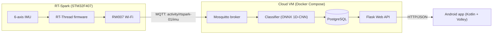

# RT-Spark Activity Recognition

[](https://github.com/TristanListanco/rt-spark-activity-recognition/actions/workflows/repo.yml)
[](https://github.com/TristanListanco/rt-spark-activity-recognition/actions/workflows/cloud.yml)
[](https://github.com/TristanListanco/rt-spark-activity-recognition/actions/workflows/ml.yml)
[](https://github.com/TristanListanco/rt-spark-activity-recognition/actions/workflows/firmware.yml)
[](https://github.com/TristanListanco/rt-spark-activity-recognition/actions/workflows/android.yml)

Laboratory Activity 3: a full-stack IoT system that classifies walking vs. running in real time.

The RT-Spark board streams accelerometer and gyroscope readings over Wi-Fi/MQTT to a cloud service. There, a small 1D-CNN classifies the activity and the result is stored in PostgreSQL. A Flask API serves the results to an Android app.

## Architecture



Message formats, API endpoints and the database schema are in [docs/CONTRACTS.md](docs/CONTRACTS.md).

## Repository layout

| Path | Contents |
|---|---|
| `firmware/` | RT-Thread project for the RT-Spark: IMU sampling, Wi-Fi, MQTT publishing |
| `cloud/` | Docker Compose stack: Mosquitto, PostgreSQL, classifier service, Flask API |
| `ml/` | Dataset exploration, preprocessing, training, exported ONNX model |
| `tools/` | `fake_publisher.py` (simulates the board), `record.py` (records labelled board data) |
| `app/` | Android app: live prediction and history |
| `docs/` | Interface contracts, ML report |

## Progress

- [x] M0: Repository set up
- [x] M1: Local cloud stack (broker, DB, API stub, fake publisher)
- [x] M1b: Firmware toolchain builds and flashes the stock BSP
- [x] M2: ML model trained and exported
- [x] M3: Classifier + API working end to end with simulated data
- [x] M4: Firmware publishes real IMU data over Wi-Fi/MQTT
- [ ] M5: Android app
- [ ] M6: Deployed to an Azure VM
- [ ] M7: Own data collected, model fine-tuned
- [ ] M8: Final test, demo video

## Running it

*Filled in as each part is built.*

### Cloud stack (local)

Needs Docker. Four services run from `cloud/docker-compose.yml`:

| Service | Port | Role |
|---|---|---|
| `mosquitto` | 1883 | MQTT broker; password auth only, credentials from `cloud/.env` |
| `db` | internal | PostgreSQL 16; schema in `cloud/db/init.sql` |
| `classifier` | — | Subscribes to `activity/+/imu` and validates each message against the contract. Keeps a 2 s window per device, classifies it once per second with `ml/models/model.onnx` (ONNX Runtime; no PyTorch in the image), and writes the result to `predictions` |
| `api` | 8000 | Flask API over the `predictions` table (contract section 4), plus a live web page at `/` |

```bash
cp cloud/.env.example cloud/.env        # then set real passwords
docker compose -f cloud/docker-compose.yml up -d --build --wait

curl http://localhost:8000/api/health
open http://localhost:8000/             # live page
```

Simulate the board with `tools/fake_publisher.py`, which reads the MQTT credentials from `cloud/.env`. Its default signals are simple but physically plausible, so the model labels them correctly. Add `--csv ml/data/dataset.csv` to replay real dataset rows instead.

```bash
python3 -m venv .venv && .venv/bin/pip install -r tools/requirements.txt
.venv/bin/python tools/fake_publisher.py                   # alternate walk/run every 30 s
.venv/bin/python tools/fake_publisher.py --activity run --count 10

curl "http://localhost:8000/api/latest?device_id=rtspark-01"
mosquitto_sub -h localhost -u device -P <MQTT_PASSWORD> -t 'activity/#' -v   # raw traffic
docker compose -f cloud/docker-compose.yml logs -f classifier                # one line per prediction
```

`cloud/scripts/smoke_test.sh` checks the whole path end to end, and CI runs the same script:
1. Start the stack and check the API and database are healthy.
2. Check the broker rejects anonymous clients.
3. Simulate a board that walks for 6 s and then runs for 6 s.
4. Expect 11 stored predictions, a latest label of "run", both activities in the history, a matching daily summary, the web page loading, and a clean classifier log.

Replaying real dataset rows through the running stack, the label switched to "run" about 1 s after the data switched.

Port 8000 is used instead of 5000 because macOS reserves 5000 for AirPlay Receiver.

### Machine learning

`ml/` is a [uv](https://docs.astral.sh/uv/) project (Python 3.12). On Linux it installs the CPU-only PyTorch build. Put the Kaggle run-or-walk CSV at `ml/data/dataset.csv` (it is not committed), then:

```bash
cd ml
uv sync
uv run python explore.py    # dataset facts + figures (docs/ml/)
uv run python evaluate.py   # compare models on unseen days, rotated devices, other wrist (~13 min)
uv run python train.py      # train the deployed model → models/model.onnx + model_meta.json
uv run pytest
```

The exported model takes raw 2 s windows `(batch, 10, 6)` in g and rad/s and returns `[walk, run]` probabilities. Magnitude channels and normalization happen inside the ONNX file, so the classifier service needs only numpy and ONNX Runtime.

### Firmware

RT-Thread on the RT-Spark, using RT-Thread's official `stm32f407-rt-spark` board package with its RW007 Wi-Fi and ICM-20608 IMU drivers. The firmware samples at 5 Hz and publishes one MQTT message per second. Details, LED meanings and serial commands: [firmware/README.md](firmware/README.md).

The only prerequisite is the Arm GCC toolchain (GCC 14.2, native on Apple Silicon, no admin rights):

```bash
pio pkg install --global --tool "platformio/toolchain-gccarmnoneeabi@1.140201.0"
```

`firmware/build.sh` does the rest: it fetches RT-Thread at a pinned commit (only the parts this board needs), installs RT-Thread Env if missing, copies this project's code and configuration onto the board package, and builds. It flashes through the on-board ST-Link with PlatformIO's OpenOCD.

```bash
cp firmware/applications/secrets.example.h firmware/applications/secrets.h   # Wi-Fi + MQTT settings
firmware/build.sh flash
pio device monitor -p /dev/cu.usbmodem* -b 115200
```

On macOS, the first time the board is plugged in you have to click **Allow** on the "Allow accessory to connect?" prompt. The board needs a **2.4 GHz, IPv4** Wi-Fi network; a phone hotspot works.

### Android app
_Coming in M5._

## Continuous integration

Each part has its own GitHub Actions workflow in `.github/workflows/`. A workflow runs only when its folder changes, and its jobs skip until that part of the project exists.

| Workflow | Runs when | What it does |
|---|---|---|
| `repo.yml` | every push/PR | Fails if `.env`, `secrets.h`, keystores or the lab handout are committed, or if any file is over 10 MB. Lints the workflows (actionlint) and all Python (ruff, config in `ruff.toml`) |
| `cloud.yml` | `cloud/`, `tools/`, `ml/activity_ml/`, `ml/models/` | `pytest` for the API and classifier against a Postgres service (`DATABASE_URL`). Builds the Compose stack and runs `cloud/scripts/smoke_test.sh` |
| `ml.yml` | `ml/` | `uv sync --locked`, then `pytest` (preprocessing and exported-model checks; no training in CI) |
| `firmware.yml` | `firmware/`, `cloud/classifier/payload.py` | Compiles the firmware's message code on the host and checks its JSON with the cloud classifier's validator. Then `firmware/build.sh` builds the image (pinned RT-Thread, cached between runs) with placeholder secrets, reports flash/RAM size, and uploads `rtthread.bin` |
| `android.yml` | `app/` | Validates the Gradle wrapper, then `lintDebug testDebugUnitTest assembleDebug`. Uploads the debug APK |

## Results

Full details in [docs/ml-report.md](docs/ml-report.md). The deployed model is a 1D-CNN with 1,218 parameters (30 KB ONNX, ≈0.01 ms per prediction), trained with left/right mirroring and random 3D rotations:

| Test | Accuracy |
|---|---|
| Unseen recording day (12-fold) | 99.71% |
| Unseen day, device rotated to a random orientation | 99.70% |
| Train left wrist → test right / train right → test left | 99.62% / 98.82% |

The same CNN trained without rotations also scores 99.9% on unseen days, but drops to 52% once the device is rotated. It learned *how the iPhone was worn* instead of how walking and running move. That is why rotation training matters for the RT-Spark. Results on data recorded with the board are added in M7.

## Demo

_Link to the demo video._
