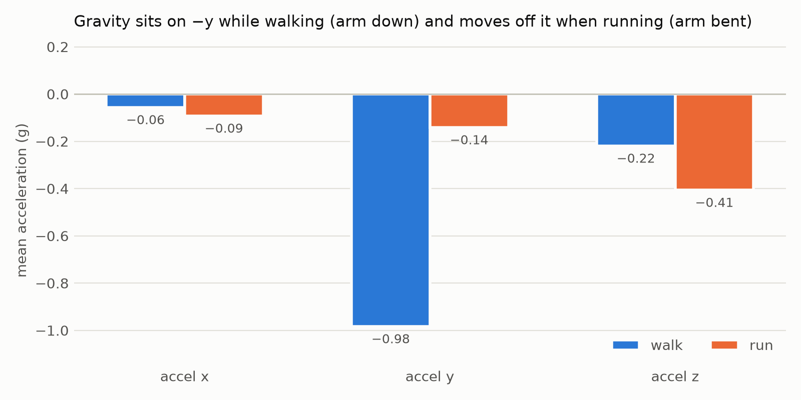
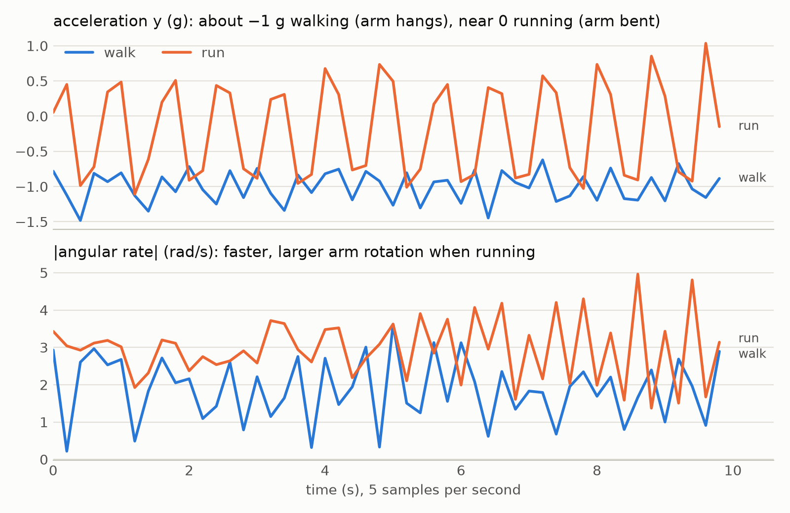

# ML report: walk/run classifier

How the model behind the activity predictions was built, tested and chosen. Every number here comes from `ml/results/dataset_facts.json` and `ml/results/evaluation.json`, which `ml/explore.py` and `ml/evaluate.py` regenerate.

## Summary

- **Data:** the Kaggle run-or-walk dataset: 88,588 samples from one person wearing an iPhone on the wrist, recorded on 12 days.
- **Units and rate, settled from the data:** 5 Hz; acceleration in g *with gravity included*; angular rate in rad/s. These are now fixed in [CONTRACTS.md](CONTRACTS.md), and the firmware must send the same.
- **Deployed model:** a 1D-CNN over 2 s windows (10 samples), trained with left/right mirroring and random 3D rotations.
  - 1,218 parameters, a 30 KB ONNX file, about 0.01 ms per prediction on a laptop CPU.
  - **99.71%** accuracy on unseen recording days, and **99.70%** when the unseen day's data is also rotated to simulate a differently mounted device.
- **The main lesson:** every model trained *without* rotations reaches 99.9% on the dataset but drops to **~52–58%**, coin-flip level, once the device orientation changes. The RT-Spark will not be worn exactly like the iPhone, so rotation training is what makes the model usable on the board.
- **Honest caveat:** a simpler model that ignores time order (logistic regression on window statistics), when also trained with rotations, is slightly *more* accurate on this dataset (99.88% vs 99.70%). Section 5 explains why the CNN is still the deployed model, and M7 re-tests both on data recorded with the board.

## 1. Dataset

| Fact | Value |
|---|---|
| Samples | 88,588 (44,223 walk, 44,365 run) |
| People | 1 (`viktor`) |
| Recording days | 12 |
| Sessions | 339, median 54 samples (≈ 11 s) |
| Wrist | 42,330 left, 46,258 right; most days use one wrist |
| Sample interval | median 0.2000 s → **5 Hz** |
| Acceleration range | −5.35 … 5.60 g |
| Angular rate range | −9.48 … 11.27 rad/s |

**Time format.** The `time` column looks like `13:51:15:847724020`. Read as hours:minutes:seconds:**nanoseconds**, consecutive samples are 0.2000 s apart (10th–90th percentile 0.199–0.201 s). Read as a decimal fraction, the gaps make no sense (thousands of negative steps). A few rows are out of order, so the loader sorts by time. It then splits the data into sessions on gaps over 1 s or a change of activity or wrist.

**Units and gravity.** The mean acceleration magnitude while walking is **1.08 g** (median 1.06). That is what an accelerometer reads with gravity included. Phone "user acceleration", which has gravity removed, would average near 0; m/s² would average near 9.8. Angular rate magnitudes average 1.9 (walk) and 2.7 (run) with a maximum of 11, which fits rad/s; deg/s would be about 57 times larger. The ICM-20608 on the board also measures gravity, so the firmware only has to convert raw counts to g and rad/s.

**Posture.** While walking, gravity sits almost entirely on the −y axis (mean −0.98 g): the arm hangs down. While running it mostly leaves −y (mean −0.14 g) and moves towards −z (−0.41 g): the arm is bent. That is a very strong clue, but it depends entirely on how the device sits on the arm.



Over time, running shows a regular arm swing of about 1.1 s on the y-axis, and larger, faster rotations:



**Wrist.** The mean x-acceleration flips sign between the left wrist (+0.57 g) and the right (−0.66 g), as expected for mirror-image placements.

## 2. Method

**Windows.** Each session is cut into overlapping windows of W samples, which never cross a session boundary. At W = 10 that gives 85,567 windows from 335 sessions (4 sessions shorter than 10 samples are dropped). Training uses every second window, which is just as effective as using all of them in half the time. Testing uses all windows.

**Model.** The model takes raw windows of shape (W, 6) and does everything else inside the network:
1. It adds two channels, |acceleration| and |angular rate|, which don't depend on orientation.
2. It standardizes all 8 channels with statistics from the training set.
3. Two 1D convolutions (16 filters, kernel 3, ReLU) slide over time. Together they see 5 consecutive samples (1 s), so they learn the *shape* of the motion over time.
4. Global average pooling and a linear layer produce 2 outputs, then softmax.

That is 1,218 parameters. Because the feature steps are inside the exported ONNX file, the live classifier feeds it exactly what the board sends, and training and serving cannot disagree.

**Augmentation.** Each training batch is changed randomly so the model can't rely on how the iPhone happened to be worn:
- **Mirroring** reflects half the windows across the body's mid-plane (left ↔ right wrist): acceleration becomes (−ax, ay, az). Angular rate is an *axial* vector, so under a reflection it becomes (gx, −gy, −gz), not just a flipped x.
- **Rotation** additionally turns acceleration and angular rate by the same uniformly random 3D rotation, so no fixed orientation can be memorized.

**Baseline.** For comparison, a model that ignores time order: the mean, standard deviation, minimum and maximum of the 8 channels in each window (32 numbers), fed to logistic regression. Swapping samples within a window doesn't change its input at all.

**Training.** Adam, learning rate 5×10⁻³ with cosine decay, batch size 512, 8 epochs, seed 0. Evaluation and the final model use exactly the same settings.

## 3. How the models were tested

A random train/test split would be meaningless here. Neighbouring windows share 9 of their 10 samples, so the test set would contain near-copies of training windows. Every protocol below keeps the test data completely separate:

| Protocol | Trains on | Tests on | What it asks |
|---|---|---|---|
| **Unseen day** | 11 of the 12 days (12 rounds) | the held-out day | Does it generalize to a new recording session? |
| **Rotated device** | 11 of the 12 days | the held-out day, with all its data turned by one fixed random rotation | Does it still work when the device sits differently on the arm? This is the situation on the RT-Spark |
| **Left → right wrist** | left-wrist data only | right-wrist data | Does it transfer to the other arm? |
| **Right → left wrist** | right-wrist data only | left-wrist data | The same, in reverse |

All results pool the predictions from every round. For the models that work, macro-F1 is within 0.1 points of accuracy, because the classes are balanced. For the models that collapse on rotated devices it is much lower (e.g. 0.39 for the plain 1D-CNN), because they predict almost only one class. The full numbers, including confusion matrices and per-day accuracy, are in `ml/results/evaluation.json`.

## 4. Results

**2 s windows (W = 10)**

| Model | Unseen day | Rotated device | Left → right wrist | Right → left wrist |
|---|---|---|---|---|
| Baseline: window statistics + logistic regression | 99.97% | 57.44% | 99.94% | 99.88% |
| Baseline, trained with rotations | 99.86% | 99.88% | 99.89% | 99.87% |
| 1D-CNN | 99.95% | 52.29% | 99.46% | 81.22% |
| 1D-CNN + wrist mirroring | 99.95% | 52.45% | 99.94% | 99.73% |
| **1D-CNN + mirroring + rotations (deployed)** | 99.71% | 99.70% | 99.62% | 98.82% |

**4 s windows (W = 20)**

| Model | Unseen day | Rotated device | Left → right wrist | Right → left wrist |
|---|---|---|---|---|
| Baseline: window statistics + logistic regression | 100.00% | 58.02% | 98.26% | 99.97% |
| Baseline, trained with rotations | 99.98% | 99.99% | 99.98% | 99.94% |
| 1D-CNN | 99.99% | 50.31% | 71.29% | 91.39% |
| 1D-CNN + wrist mirroring | 99.98% | 50.90% | 99.98% | 99.93% |
| 1D-CNN + mirroring + rotations | 99.82% | 99.85% | 99.67% | 99.38% |

What the numbers show:
1. **The dataset alone is easy.** On unseen days every model scores ≥ 99.7%. Holding out a day is not a hard enough test on its own.
2. **Without augmentation the CNN memorizes posture.** It drops to 81% (2 s) or 71% (4 s) on the other wrist. Mirroring fixes that.
3. **Only rotation training survives a turned device.** Every model trained without rotations collapses to 50–58%: it calls almost everything "run", because "gravity is not on −y" is what it learned running looks like. With rotation training both model types stay above 99.7%.
4. **Longer windows help slightly** (the rotation-trained CNN goes from 99.70% to 99.85% on rotated devices), but make the prediction react more slowly.

For the deployed model, the unseen-day confusion matrix (all 12 rounds pooled) is:

| | predicted walk | predicted run |
|---|---|---|
| **walk** | 42,987 | 120 |
| **run** | 126 | 42,334 |

Its worst single day scores 99.0%, both normally and rotated.

## 5. Choosing the deployed model

**Rotation training is required.** The board's sensor axes will not line up with the iPhone's, so a model that relies on orientation would most likely fail on real board data, however good its dataset scores.

**Two rotation-trained candidates remain.** The CNN makes 255 errors on the 85,567 rotated-device windows; the statistics baseline makes 104. The baseline is slightly better on this dataset. The CNN is deployed anyway, for these reasons:
- **The lab asks for a model that uses temporal information,** built with TensorFlow or PyTorch. The CNN learns motion patterns over time; the baseline throws time order away by construction.
- **The gap is small** (99.70% vs 99.88%), and this dataset has one person and one device. Which model transfers better to a different person and board is still an open question.
- **M7 will settle it with real data.** I'll record walking and running with the RT-Spark and re-test both models. If the baseline is clearly better on board data, it can be exported the same way (logistic regression is a single linear layer).

**2 s windows (W = 10) instead of 4 s.** The label reacts about 2 s faster when you change pace, for a 0.15-point accuracy cost.

## 6. The lab's design questions

- **Temporal information.** The CNN's convolutions run along time and learn the shape of a 1 s stretch of motion. The baseline shows that on this dataset an order-free model is competitive, because walking and running also differ in overall intensity: mean angular rate is 1.9 vs 2.7 rad/s. I report that rather than hide it.
- **Sophisticated vs lightweight.** Lightweight. The model has 1,218 parameters, the whole training set fits in memory, and one training run takes about 10 s on a laptop CPU. A larger model has nothing left to gain here: the remaining errors come from orientation and transfer, not from capacity.
- **Compute vs memory.** Neither is a constraint at this size. The model file is 30 KB and one prediction takes about 0.01 ms, so the 1 GB Azure VM runs it easily with ONNX Runtime alone (no PyTorch needed).
- **Probabilistic output.** Yes: the softmax output is reported as the prediction's confidence and shown in the app. These probabilities are not calibrated, so read 0.95 as "confident", not as an exact 95% chance.

## 7. Deployed model

| | |
|---|---|
| File | `ml/models/model.onnx` (30,634 bytes), described by `ml/models/model_meta.json` |
| Input `imu` | float32 (batch, 10, 6): raw `[ax, ay, az, gx, gy, gz]` in g and rad/s, 5 Hz, oldest sample first |
| Output `probs` | float32 (batch, 2): probabilities for `[walk, run]` |
| Check | ONNX Runtime output matches PyTorch to within 5×10⁻⁷ |
| Speed | ≈ 0.01 ms per window (ONNX Runtime, CPU) |

## 8. Limitations

- **One person and one phone.** Results across days and wrists can't show how the model handles other people or other sensors. The board recordings in M7 are the real test.
- **5 Hz sampling** captures movement up to 2.5 Hz. Arm swing (about 1 Hz) is well covered; finer detail of each footstep is not.
- **Two classes only.** Standing still is not a class, so it will be labelled as whichever of walk or run it looks more like. Adding an "idle" class would need data recorded for it.

## 9. Reproduce

```bash
cd ml
uv sync                                  # Python 3.12 environment from uv.lock
# put the Kaggle CSV at ml/data/dataset.csv (not committed)
uv run python explore.py                 # dataset facts + figures
uv run python evaluate.py                # all protocols, about 13 min on a laptop CPU
uv run python train.py                   # final model → models/model.onnx
uv run pytest                            # preprocessing, model and exported-file tests
```

## 10. Results on board data (M7)

_To be added after recording with the RT-Spark._
